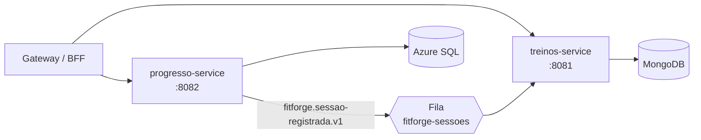
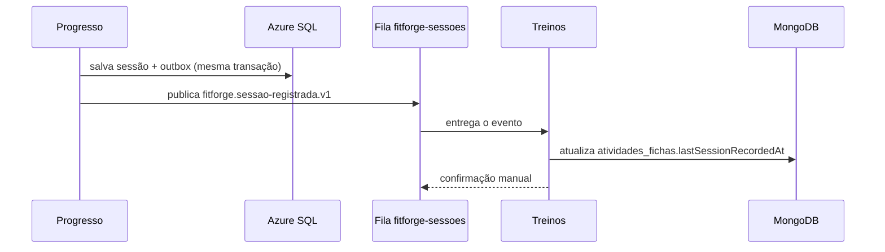

# FitForge — Microsserviços

Backend do FitForge em **Java 21 / Spring Boot**, organizado como projeto **Maven multimódulo**. Os serviços de **Treinos** e **Progresso** têm domínios e persistências separados e se comunicam por mensageria (Azure Service Bus). Cada módulo possui CRUD, Swagger, testes unitários e testes de arquitetura.

**Integrantes:** Andryus Zolet, Nicolas Medeiros, Valentin Rojas e Leonardo Henrique. Detalhes em [GRUPO.md](GRUPO.md).

## Sumário

- [Links](#links)
- [Módulos](#módulos)
- [Arquitetura](#arquitetura)
- [Pré-requisitos](#pré-requisitos)
- [Execução local](#execução-local)
- [Testes](#testes)
- [Azure SQL e perfil Azure](#azure-sql-e-perfil-azure)
- [Service Bus e regra de negócio](#service-bus-e-regra-de-negócio)
- [Variáveis de configuração](#variáveis-de-configuração)
- [Publicação](#publicação)
- [Estrutura do repositório](#estrutura-do-repositório)
- [Documentação e entrega](#documentação-e-entrega)
- [Status e limitações](#status-e-limitações)

## Links

O frontend usa o Gateway. Os dados dos serviços diretos devem exigir a chave interna.

| Recurso | Endereço |
| --- | --- |
| Frontend (Azure) | https://c4pivara35.z21.web.core.windows.net/ |
| Gateway (Azure) | https://fitforge-gateway-hvaqcubhf8d0a2hc.chilecentral-01.azurewebsites.net |
| Swagger Treinos | https://fitforge-treinos-cchfd7b9dyf7cjgu.mexicocentral-01.azurewebsites.net/swagger-ui.html |
| Swagger Progresso | https://fitforge-progresso-gvfgfua7b0dggrht.mexicocentral-01.azurewebsites.net/swagger-ui.html |
| Repositório do frontend | https://github.com/C4pivara35/FitForge |
| Repositório do Gateway | https://github.com/C4pivara35/FitForge-API_Gateway |

## Módulos

| Módulo | Porta local | Banco local | Banco na Azure | Domínio |
| --- | --- | --- | --- | --- |
| `treinos-service` | 8081 | MongoDB (27017) | MongoDB / CosmosDB compatível | Fichas e exercícios |
| `progresso-service` | 8082 | H2 | Azure SQL Database | Sessões e histórico |

## Arquitetura



Decisões principais:

- **Vertical Slice Architecture**, com separação interna de responsabilidades e dependências verificadas por testes de arquitetura.
- **Persistência separada por serviço:** Treinos usa Mongo, Progresso usa SQL.
- **Comunicação assíncrona** entre os serviços com o padrão *outbox*, para não perder eventos.
- A aplicação de SOLID e os limites do desenho estão detalhados na Arc42.

## Pré-requisitos

- JDK **21**
- Maven
- Docker (para o MongoDB local e para os testes com Testcontainers)

## Execução local

**1. Suba o MongoDB** na porta 27017 (com o Docker Desktop iniciado):

```bash
docker run --name fitforge-mongo-local -d -p 127.0.0.1:27017:27017 -v fitforge-mongo-local:/data/db mongo:7.0
```

Se o container já existir, use `docker start fitforge-mongo-local`.

**2. Em dois terminais separados**, a partir da raiz do repositório:

```bash
mvn -pl treinos-service spring-boot:run
```

```bash
mvn -pl progresso-service spring-boot:run
```

O repositório também traz `start-all.bat` (Windows) e `start-all.sh` (Linux/macOS) como atalho de inicialização.

**Comportamento padrão no modo local**

- Treinos usa Mongo local e aceita `MONGODB_URI` e `MONGODB_DATABASE`.
- Progresso usa H2.
- O Service Bus fica **desativado** por padrão.

**Swagger local**

- Treinos: http://localhost:8081/swagger-ui.html
- Progresso: http://localhost:8082/swagger-ui.html

## Testes

```bash
mvn -B clean verify
```

- **Treinos** usa Testcontainers com Docker, ou um Mongo de teste indicado em `FITFORGE_TEST_MONGODB_URI`, criando bancos temporários por contexto.
- **Progresso** usa H2 para testes rápidos.
- Cobertura: serviços isolados, outbox, CRUD, contas, arquitetura e projeção idempotente.
- Os testes **não** usam o perfil Azure e **não** exigem credenciais de produção.

> H2 aprovado em teste **não comprova** o funcionamento do SQL na nuvem.

## Azure SQL e perfil Azure

Configure `SPRING_PROFILES_ACTIVE=azure` nos dois apps.

**Progresso**

- `DB_URL`: URL JDBC do SQL Server, com TLS.
- `DB_USER` e `DB_PASSWORD`.
- `DB_DDL_AUTO=update` para o bootstrap inicial.
- O perfil exige URL e driver SQL Server, para nunca operar silenciosamente com H2.
- Pool máximo: três conexões.
- Depois de criar o esquema, evoluir para `validate` e migrações versionadas é o caminho recomendado.

**Treinos**

- `MONGODB_URI` real e `MONGODB_DATABASE=fitforge-treinos`.

**Nos dois**

- `SEED_DATA=false`.
- `FITFORGE_INTERNAL_KEY` com o mesmo segredo configurado no Gateway.
- Libere os IPs de saída de Progresso no servidor SQL e os de Treinos no cluster Mongo.

Para conferir o banco, há um [SQL de inspeção somente leitura](docs/sql/VERIFICAR-AZURE-SQL.sql), para executar no Query editor do recurso Azure SQL real.

> Não existem senhas de banco neste repositório. Os dados do H2 anterior **não** migram automaticamente.

## Service Bus e regra de negócio



**Como funciona**

1. Ao criar uma sessão, Progresso salva a sessão e a entrada de outbox **na mesma transação SQL**.
2. O publicador envia o evento `fitforge.sessao-registrada.v1` para a fila `fitforge-sessoes`.
3. Treinos consome o evento e atualiza `atividades_fichas.lastSessionRecordedAt` no Mongo, para a ficha e o proprietário correspondentes.
4. A consulta `/api/treinos/{id}/atividade` expõe esse efeito pelo Gateway.

**Configuração (nos dois apps)**

- `SERVICE_BUS_ENABLED=true`
- `SERVICE_BUS_QUEUE=fitforge-sessoes`
- `SERVICE_BUS_CONNECTION_STRING`: use a política **Send** em Progresso e **Listen** em Treinos.
- O transporte usa AMQP sobre WebSockets na porta 443.
- A fila **não** deve exigir Service Bus Sessions.

**Garantias e limites**

- Há retry da outbox e confirmação manual no consumidor.
- A entrega é **at-least-once**; o maior timestamp torna a projeção idempotente.
- Atualizar ou excluir uma sessão **não** desfaz a projeção de registro.
- **Não** se afirma exactly-once nem contagem exata de sessões pelo evento.

## Variáveis de configuração

| Variável | Serviço | Descrição |
| --- | --- | --- |
| `SPRING_PROFILES_ACTIVE` | Ambos | Use `azure` em produção. |
| `FITFORGE_INTERNAL_KEY` | Ambos | Mesmo segredo do Gateway. |
| `SEED_DATA` | Ambos | `false` na Azure. |
| `MONGODB_URI` | Treinos | URI do Mongo (padrão local: `localhost:27017`). |
| `MONGODB_DATABASE` | Treinos | `fitforge-treinos` na Azure. |
| `FITFORGE_TEST_MONGODB_URI` | Treinos (testes) | Mongo de teste, alternativa ao Testcontainers. |
| `DB_URL` | Progresso | URL JDBC do SQL Server com TLS. |
| `DB_USER` / `DB_PASSWORD` | Progresso | Credenciais do Azure SQL. |
| `DB_DDL_AUTO` | Progresso | `update` no bootstrap. |
| `SERVICE_BUS_ENABLED` | Ambos | Ativa a mensageria (desativada por padrão no local). |
| `SERVICE_BUS_QUEUE` | Ambos | `fitforge-sessoes`. |
| `SERVICE_BUS_CONNECTION_STRING` | Ambos | Send em Progresso, Listen em Treinos. |

> Valores reais ficam nos App Services da Azure, nunca no Git.

## Publicação

Os dois workflows existentes compilam, testam e publicam o `app.jar` de cada módulo. As conexões reais e o perfil ativo são configurados nos App Services. Alterações na pasta `docs/` da raiz **não** disparam esses deploys.

O perfil Azure exige recursos já preparados; siga o [guia de deploy](docs/DEPLOY-AZURE.md) antes de ativá-lo.

## Estrutura do repositório

```text
FitForge-Microservicos/
├── treinos-service/                   # módulo Treinos (Mongo)
├── progresso-service/                 # módulo Progresso (SQL + outbox)
├── .github/workflows/                 # pipelines de build, teste e deploy
├── docs/                              # Arc42, checklist, guia de deploy e SQL de inspeção
├── pom.xml                            # Maven multimódulo
├── start-all.bat                      # atalho de execução (Windows)
├── start-all.sh                       # atalho de execução (Linux/macOS)
├── ARC42-FitForge-Microservicos.docx  # versão Word da Arc42
└── GRUPO.md                           # integrantes do grupo
```

## Documentação e entrega

- [Arc42 completa (12 seções)](docs/ARC42.md)
- [Checklist de validação e evidências](docs/VALIDACAO-ENTREGA.md)
- [Guia detalhado de Azure SQL, Service Bus e publicação](docs/DEPLOY-AZURE.md)
- [Integrantes do grupo](GRUPO.md)

## Status e limitações

- Código e CI aprovados **não** comprovam a ativação de SQL e mensageria; essa conclusão depende da configuração e das evidências na Azure.
- **Vídeo de apresentação:** pendente de gravação e publicação como não listado no YouTube. Inserir o link aqui após validar o fluxo em nuvem, com todos os integrantes falando e com a câmera aberta.
