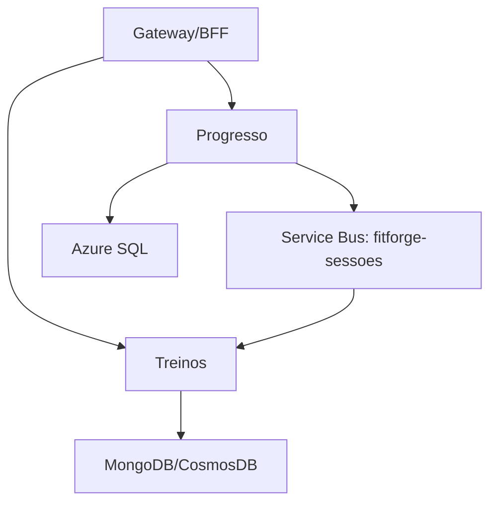
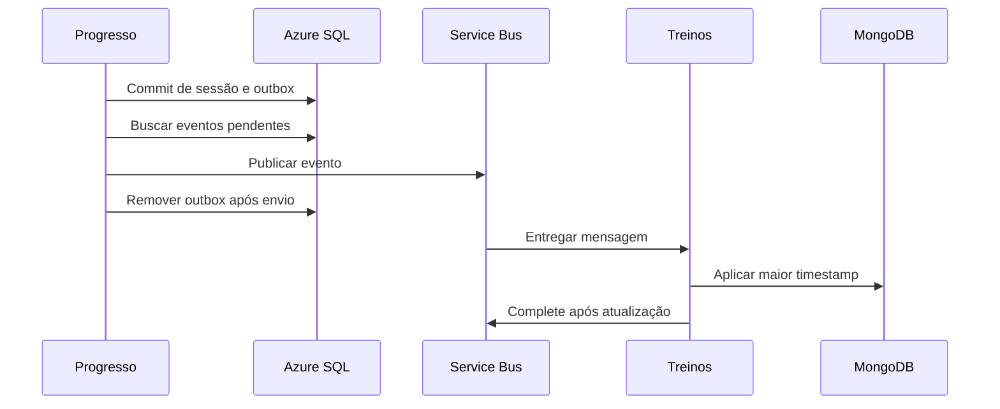

# Arc42 — FitForge Microsserviços

Versão: 1.0 — 17/11/2026. Equipe: Andryus Zolet, Nicolas Medeiros, Valentin Rojas e Leonardo Henrique.

Escopo: módulos `treinos-service` e `progresso-service`. Configuração de implantação e resultados de execução são assuntos distintos: Azure SQL e Service Bus só devem ser considerados concluídos depois das evidências do [checklist](VALIDACAO-ENTREGA.md).

## 1. Introdução e objetivos

Treinos administra fichas e exercícios. Progresso administra sessões realizadas e seus indicadores. Os serviços oferecem CRUD e Swagger, possuem persistências distintas e trocam um evento de negócio por Azure Service Bus.

A regra assíncrona implementada é: **ao registrar uma sessão, Progresso publica o registro, e Treinos atualiza a data do último registro recebido para a ficha**. O histórico de sessões é preservado quando uma ficha é excluída.

| Interessado | Necessidade |
|---|---|
| Pessoa que treina | Salvar plano e histórico com dados persistentes |
| Gateway/BFF | Receber APIs independentes e compor o painel |
| Equipe | Demonstrar bancos separados, regra assíncrona e testes |
| Avaliador | Ver CRUD na nuvem e alterações nos bancos reais |

Prioridades: persistência correta, isolamento dos bancos, entrega recuperável de eventos, segurança de acesso e testabilidade. Contagem exata de eventos e transações distribuídas entre SQL e Mongo não são garantias desta solução.

## 2. Restrições

Java 21, Spring Boot 3.3.4 e Maven multimódulo. Treinos usa Spring Data MongoDB, compatível com MongoDB/CosmosDB conforme o enunciado. Progresso usa Spring Data JPA e o driver Microsoft SQL Server para Azure SQL. H2 permanece como recurso local/teste. O perfil `azure` exige URL externa e driver SQL Server para evitar fallback acidental para H2.

A rubrica menciona Atlas e Azure SQL “Free 1 DTU”. O enunciado geral aceita CosmosDB. A oferta gratuita atual do SQL pode ser serverless baseada em vCore; documentar o produto/tier realmente provisionado e alinhar equivalência com o professor. Não apresentar H2 ou SQL Server em Docker como prova de Azure SQL.

O plano gratuito dos App Services tem limites de CPU e cold start. Broker e bancos possuem cobrança/cotas próprias. Credenciais e publish profiles ficam fora do Git.

## 3. Contexto e escopo

| Interface | Contrato |
|---|---|
| Gateway → Treinos | HTTPS JSON `/api/treinos`, `/{id}`, `/estatisticas`, `/{id}/atividade` |
| Gateway → Progresso | HTTPS JSON `/api/sessoes`, `/{id}`, `/estatisticas` |
| Gateway → contas | HTTPS JSON `/api/internal/accounts` e autenticação interna |
| Treinos → MongoDB | Driver MongoDB, banco exclusivo `fitforge-treinos` |
| Progresso → SQL | JDBC TLS, banco exclusivo de Progresso |
| Progresso → broker → Treinos | Evento `fitforge.sessao-registrada.v1`, JSON e AMQP sobre WebSockets |

Cada API valida `X-FitForge-Internal-Key` quando configurado. `X-FitForge-Owner` vem do Gateway, não de um valor confiado ao navegador. Os bancos não são acessados pelo BFF nem compartilhados entre serviços.

## 4. Estratégia da solução

O padrão é **Vertical Slice Architecture**. Cada domínio agrupa controller, DTO, service, model e repository; persistência e mensageria pertencem à fatia correspondente. A entrada HTTP delega os casos de uso ao serviço. Dependências são fornecidas por construtor, permitindo testes isolados.

Treinos persiste a ficha com seus exercícios em um documento. Progresso persiste sessões e outbox em uma transação SQL local. Um publicador separado envia eventos pendentes; o consumidor atualiza uma projeção MongoDB e confirma a mensagem. Não existe transação única envolvendo os dois bancos e o broker.

A solução aplica princípios SOLID sem declarar que entidades anotadas com JPA/Mongo são um domínio totalmente independente de frameworks.

## 5. Visão de blocos

### 5.1 Treinos

| Bloco | Código | Papel |
|---|---|---|
| Entrada HTTP | `workouts/controller/WorkoutController` | CRUD, estatísticas e atividade |
| Contratos | `workouts/dto/*` | Validações de ficha e exercícios |
| Caso de uso | `workouts/service/WorkoutService` | Proprietário, conflitos e alterações |
| Modelo/persistência | `workouts/model/*`, `workouts/repository/WorkoutRepository` | Coleção `treinos`, string ID e versionamento otimista |
| Projeção | `workouts/activity/WorkoutActivities`, `WorkoutActivity` | Coleção `atividades_fichas` |
| Consumidor | `workouts/activity/SessionEventConsumer` | Validar mensagem e confirmar/abandonar/dead-letter |
| Infraestrutura | `config/*`, `exception/*` | Segurança interna, CORS, inicialização e erros |

### 5.2 Progresso

| Bloco | Código | Papel |
|---|---|---|
| Entrada HTTP | `sessions/controller/SessionController` | CRUD de sessões e estatísticas |
| Caso de uso | `sessions/service/SessionService` | Validação temporal, histórico e transação |
| Persistência | `sessions/model/Session`, `sessions/repository/SessionRepository` | Tabela `sessoes` |
| Registro do evento | `sessions/events/SessionEvents` | Gravar outbox na transação da sessão |
| Outbox/publicador | `SessionRegistered`, `SessionOutboxRepository`, `SessionEventPublisher` | Tabela `session_event_outbox` e envio com retry |
| Contas | `accounts/*` | Tabela `fitforge_accounts`, BCrypt e endpoints internos |
| Infraestrutura | `config/*`, `exception/*` | Segurança, CORS, Clock e erros |

### 5.3 Modelo de dados

MongoDB: `treinos` contém `_id`, proprietário, nome, descrição, dias, exercícios, versão e timestamps. `atividades_fichas` contém `_id` igual ao ID da ficha, proprietário e `lastSessionRecordedAt`.

SQL: `sessoes` contém ID, `owner_username`, referência e nome histórico da ficha, data, duração, esforço, peso opcional, notas e timestamps. `session_event_outbox` mantém evento, sessão, ficha, proprietário, ocorrência e próxima tentativa. `fitforge_accounts` armazena nome de usuário e hash; nunca senha em claro.

O identificador da ficha em SQL é uma referência lógica, sem foreign key para MongoDB. Esse desacoplamento preserva histórico e evita acesso cruzado a bancos.

## 6. Visão de execução

### 6.1 CRUD de ficha

O Gateway autentica e encaminha a chave/proprietário. O controller valida o DTO. O serviço consulta/grava pelo repository MongoDB. POST retorna `201`; leitura e atualização retornam `200`; exclusão retorna `204`; item ausente retorna `404`. Validação e conflitos usam os handlers do projeto. O versionamento Mongo reduz o risco de sobrescrita concorrente.

### 6.2 Sessão e outbox

`SessionService.criar` inicia transação, valida data não futura e salva a sessão. `SessionEvents.registered` grava um `SessionRegistered` quando o broker está habilitado. O commit grava os dois registros no mesmo banco. Falha na transação impede a confirmação consistente de ambos. O envio ao broker ocorre depois, separado do tempo de resposta do CRUD.

### 6.3 Entrega e projeção

O dispatcher verifica até 20 eventos elegíveis por ciclo, padrão de 3 segundos. Se o envio falha, mantém o evento e adia nova tentativa por 30 segundos. Se o envio foi aceito e a remoção da outbox falhou, pode haver reenvio: a solução é **at-least-once**, não exactly-once.

Treinos valida assunto, corpo e campos necessários. Mensagem inválida vai para dead-letter. Falha ao projetar causa `abandon`, permitindo nova entrega. O consumidor usa `$max` para preservar o maior timestamp recebido, mesmo em repetição ou ordem invertida. A data representa o instante de registro/publicação, não a data em que o treino foi realizado. Ficha inexistente ou de outro proprietário não recebe projeção, e a mensagem pode ser concluída sem efeito.

### 6.4 Exclusões e falhas

Excluir uma ficha não apaga sessões SQL. O BFF consegue mostrar que a ficha não está mais disponível. Excluir uma sessão não desfaz a projeção de registro no MongoDB; a projeção é de evento recebido, não um contador exato do histórico vigente. Broker indisponível não deve apagar o evento SQL já confirmado. Queda permanente dos serviços exige intervenção/correção, não apenas retry.

## 7. Visão de implantação

| Componente | Local | Azure |
|---|---|---|
| Treinos | `localhost:8081`, Mongo local | [App Treinos](https://fitforge-treinos-cchfd7b9dyf7cjgu.mexicocentral-01.azurewebsites.net), Mongo/Cosmos |
| Progresso | `localhost:8082`, H2 | [App Progresso](https://fitforge-progresso-gvfgfua7b0dggrht.mexicocentral-01.azurewebsites.net), Azure SQL |
| Mensageria | Desativada por padrão | Namespace Service Bus e fila `fitforge-sessoes` |

Ativar `SPRING_PROFILES_ACTIVE=azure` em ambos. Progresso precisa de `DB_URL`, `DB_USER`, `DB_PASSWORD` e `DB_DDL_AUTO`. Treinos precisa de `MONGODB_URI` e `MONGODB_DATABASE`. Ambos precisam da chave interna, `SERVICE_BUS_ENABLED=true`, fila e conexão do broker. Progresso utiliza credencial SAS Send; Treinos utiliza Listen. O SDK usa WebSockets pela porta 443 neste pacote.

O usuário SQL de aplicação deve ter acesso apenas ao banco de Progresso. A primeira implantação pode usar `DB_DDL_AUTO=update` com permissão de DDL; após criar o esquema, `validate` evita mudanças automáticas. Não usar `create`/`create-drop` em banco com dados. Firewalls recebem os IPs de saída do app correspondente, não seu inbound IP.

GitHub Actions tem um workflow por módulo com filtros por caminho, compila/testa e publica o JAR. Backend Markdown na pasta raiz `docs` não dispara esses deploys. O estado de H2 em memória não migra automaticamente para SQL. Exportar registros reais antes da troca, se necessário, sem publicar dados pessoais ou credenciais no Git.

## 8. Conceitos transversais

### Arquitetura e SOLID

| Princípio | Aplicação e evidência |
|---|---|
| SRP | Controller recebe HTTP; service aplica regras; repository persiste; publisher envia |
| OCP | Transporte/publicação ficam fora do CRUD; projeções podem evoluir sem colocar SDK no controller |
| LSP | Repositories e colaboradores substituídos em testes preservam os contratos esperados |
| ISP | Contratos e consultas pertencem a cada domínio; serviços não importam entidades do outro módulo |
| DIP | Colaboradores e Clock são injetados; domínio de sessões registra evento sem chamar SDK Azure |

Repositories são interfaces Spring Data. O publicador recebe envio como `Consumer<ServiceBusMessage>` no dispatcher, permitindo testar sucesso/falha sem rede. Há dependências de JPA/Mongo no modelo, uma escolha compatível com vertical slice e registrada como limite.

### Segurança e isolamento

Chave interna compartilhada nos três apps, autenticação do usuário no Gateway, proprietário por registro, senha de conta BCrypt e TLS nos serviços externos. Não há banco compartilhado nem credencial Mongo em Progresso. CORS sozinho não protege uma API de chamadas externas. Health e Swagger são públicos para diagnóstico/documentação; dados de negócio exigem a chave após configurados.

### Eventos e confiabilidade

Assunto `fitforge.sessao-registrada.v1`, content type JSON, message ID estável por evento. Corpo contém `eventId`, `sessionId`, `workoutId`, `owner`, `occurredAt`. Contrato versionado permite evolução controlada. Outbox cobre a lacuna entre commit SQL e publicação. `$max` torna o efeito atual idempotente, mas não representa deduplicação genérica de qualquer regra futura.

### Testes e logs

Testes isolados cobrem serviços e dispatcher, incluindo retry sem perda. Integração cobre CRUD e projeção repetida/fora de ordem. Treinos usa Testcontainers ou `FITFORGE_TEST_MONGODB_URI` com bancos temporários; Progresso usa H2 para testes rápidos. ArchUnit impede controller de depender de repository/SDK e serviço de depender de controller. Testar em H2 não substitui validar DDL e persistência no Azure SQL real.

Logs `Evento enviado id=... ficha=...` e `Evento processado id=... ficha=...` permitem relacionar envio e consumo. Não registrar connection strings ou senhas. Métricas do portal do broker podem atrasar e fila vazia pode significar consumo rápido, não ausência de envio.

## 9. Decisões arquiteturais

| ADR | Decisão | Consequência |
|---|---|---|
| MS-01 | Vertical slice por domínio | Funcionalidade coesa com camadas internas; alguns detalhes de framework permanecem no modelo |
| MS-02 | Database per Service | Mongo para documento da ficha e SQL para sessão/outbox; sem join distribuído |
| MS-03 | Guardar nome histórico da ficha na sessão | Preserva leitura após renomear/excluir ficha; informação denormalizada |
| MS-04 | Outbox transacional | Evita perder intenção de evento após commit; exige tabela, polling e retry |
| MS-05 | Projeção com maior timestamp | Tolera duplicidade e ordem invertida; não contabiliza exatamente sessões vigentes |
| MS-06 | Perfil Azure sem fallback H2 | Configuração incompleta interrompe startup; erro fica visível antes da demonstração |
| MS-07 | AMQP sobre WebSockets | Usa porta 443; exige conectividade HTTPS ao namespace |
| MS-08 | Send e Listen separados | Cada serviço recebe permissão mínima de broker para sua função |

## 10. Requisitos de qualidade

Critérios de aceitação; desempenho ainda precisa de medição no ambiente real.

| Cenário | Ambiente/estímulo | Resposta verificável |
|---|---|---|
| QM-01 Persistência | Registrar sessão no app publicado | Linha presente em `sessoes` no Azure SQL |
| QM-02 Recuperação | Broker falha após commit | Outbox mantém registro e reagenda envio |
| QM-03 Assincronia | Broker e serviços disponíveis | Sessão gera envio, consumo e timestamp Mongo; alvo de demonstração até 60 s, sujeito a cold start |
| QM-04 Idempotência | Mesmo evento ou mais antigo entregue de novo | Timestamp não regride e não cria atividade adicional para a ficha |
| QM-05 Segurança | Cliente sem chave chama serviço diretamente | `403`; Gateway com chave continua operando |
| QM-06 Isolamento | Progresso executa CRUD | Nenhuma conexão MongoDB usada por Progresso |
| QM-07 Configuração | Perfil Azure sem DB_URL | Aplicação não opera silenciosamente com H2 |
| QM-08 Histórico | Excluir ficha com sessões | Sessões permanecem no SQL |

Árvore de qualidade: integridade → commit local/outbox; confiabilidade → retry/idempotência; segurança → TLS/chave/escopo; modificabilidade → domínios separados; testabilidade → repositórios e Clock substituíveis.

## 11. Riscos e dívida técnica

| Risco | Tratamento |
|---|---|
| Banco SQL criado mas não conectado | Conferir DB_URL, logs e consulta no banco real |
| SQL configurado somente com Entra | Ajustar autenticação ou implementar identidade gerenciada; usuário/senha SQL não funciona em modo Entra-only |
| Cota F1, RAM ou cold start | Pool pequeno, observar cotas e evitar deploys repetidos |
| Outbox processada por múltiplas réplicas | Possíveis envios duplicados; projeção atual tolera, mas regras futuras precisam de coordenação/claim |
| Fila possui sessões habilitadas | Consumidor atual não é session-aware; criar fila sem esse recurso |
| `ddl-auto=update` em produção | Usar apenas no bootstrap da entrega e evoluir para migrações versionadas |
| Conta SQL com privilégios amplos | Restringir banco e permissões após bootstrap |
| Projeção de ficha removida | Dados órfãos podem permanecer; planejar limpeza conforme política do produto |
| Testes H2 não cobrem dialeto SQL Server | Executar checklist no Azure SQL e acrescentar integração com SQL Server futuramente |

Na revisão anterior a esta atualização, o ambiente usava H2 em Progresso e o broker estava desativado. Não se marca esses itens como concluídos até obter as evidências. O vídeo fica para etapa posterior.

## 12. Glossário

| Termo | Definição |
|---|---|
| Database per Service | Cada serviço é proprietário exclusivo de sua persistência |
| Outbox | Registro de evento no mesmo banco/transação do dado de negócio |
| At-least-once | Entrega pode acontecer mais de uma vez |
| Idempotência | Repetir a mensagem não altera indevidamente o resultado |
| Dead-letter | Área do broker para mensagens inválidas/não processáveis |
| SAS Send/Listen | Permissões de publicar e receber no Service Bus |
| Projeção | Estado derivado do evento em outro armazenamento |
| Consistência eventual | Atualização do consumidor pode acontecer após a confirmação do produtor |
| Ficha | Documento de planejamento e exercícios |
| Sessão | Registro histórico de uma prática de treino |
| Vertical Slice | Organização de código por funcionalidade/domínio |

Referências: [arc42](https://arc42.org/overview/), [JDBC e Azure SQL](https://learn.microsoft.com/en-us/azure/azure-sql/database/connect-query-java?view=azuresql), [fila no portal](https://learn.microsoft.com/en-us/azure/service-bus-messaging/service-bus-quickstart-portal), [permissões SAS](https://learn.microsoft.com/en-us/azure/service-bus-messaging/service-bus-sas), [oferta gratuita SQL](https://learn.microsoft.com/en-us/azure/azure-sql/database/free-tier?view=azuresql).
